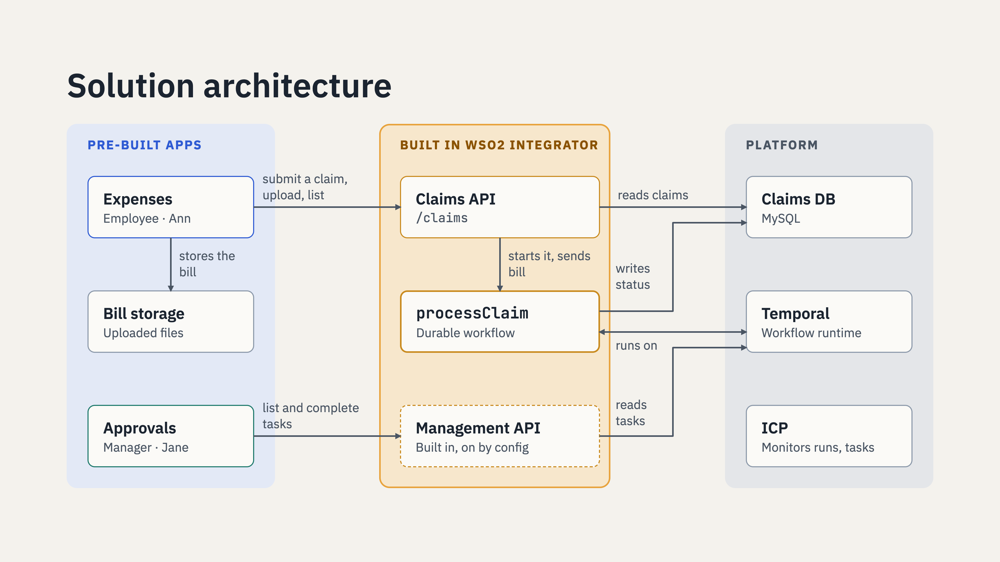

# Workflows that wait for people: a claim approval demo

An expense claim approval, run by a durable workflow built in WSO2 Integrator. Ann files a claim, the workflow asks
her for the bill, then asks her manager, Jane, to approve. Nothing polls, nothing is lost on a restart, and the apps
around it hold no process logic.



Everything runs in one Docker Compose stack: the web app, the integration, sign-in, the WSO2 Integration Control
Plane (ICP), Temporal and MySQL.

## Run it

You need Docker with Compose, and about 6 GB of memory for Docker.

```sh
docker compose up -d --build
```

The first start builds the integration and downloads ICP 2.1.0, so it takes a few minutes. When
`docker compose ps` shows everything running, open **http://localhost:8080**.

| User | Password | Can use |
|---|---|---|
| `ann@example.com` | `demo123` | **Expenses** (`/claims/`): file claims, upload bills |
| `jane@example.com` | `demo123` | **Expenses**, and **Approvals** (`/admin/`): approve or reject claims |

The ICP console is at **https://localhost:9446** (`admin` / `admin`; accept the self-signed certificate).

To start over with empty data: `docker compose down -v`.

## Try it

1. Sign in as Ann at http://localhost:8080/claims/ and click **+ New claim**. The claim shows **Bill required**: the
   workflow started and is waiting for the bill.
2. Click **Submit bill** and upload any image. The claim moves to **Waiting for approval**.
3. In a private window (each window keeps its own sign-in), sign in as Jane at http://localhost:8080/admin/. The
   approval task is there, with the bill. Add a comment and **Approve**.
4. Back in Ann's window, the claim shows **Approved** with Jane's comment.
5. In ICP, open the `claims` project: the workflow run, its steps and the human task are there.

## What is inside

| Service | What it is | Port |
|---|---|---|
| `web` | nginx: the two contexts (`/claims/`, `/admin/`), sign-in (`/login/`), bill storage, and the gateway to the APIs | 8080 |
| `integration` | The claims integration from `integration/`: the Claims API, the `processClaim` workflow, and the Workflow Management API | internal |
| `identity` | Username and password sign-in (`identity/`) | internal |
| `icp` | WSO2 Integration Control Plane 2.1.0, from its GitHub release | 9446 |
| `icp-seed` | Mints the secret the integration registers with ICP, on first start | |
| `temporal` | The durable workflow runtime | 7233 |
| `mysql` | Claims, users, ICP and Temporal data (`db/` runs on first start) | 3306 |

### How sign-in works

The identity service checks the password (stored as a bcrypt hash) and sets a session cookie. On every API and file
call, nginx asks the identity service who the session belongs to and forwards that user to the integration as
`x-user-id` and `x-user-roles`, replacing anything the browser sent. The apps never handle a token, and the Workflow
Management API lists only the tasks the signed-in user may act on (Jane's `MANAGER` role). The users and passwords are
in `config/identity.toml`. This is demo-grade sign-in: use a real identity provider for anything beyond a demo.

## The integration

`integration/` is the WSO2 Integrator project, as built in the designer: open the folder in WSO2 Integrator to see the
workflow, the activities, the HTTP service and the connection.

- `processClaim` records the claim, waits for the bill (`Await Data`), attaches it, asks a `MANAGER` (`Human Task`),
  and records the decision.
- The Claims API (`/claims`) starts the workflow with `runWithId`, so the claim id is the workflow id; the bill route
  sends the bill to that id (`Send Data Event`); `GET /claims` lists an employee's claims.
- The Workflow Management API is switched on (`Enable Workflow Management REST API` on the overview), and ICP
  monitoring is enabled (the `wso2/icp.runtime.bridge` import).

To run it from WSO2 Integrator against this stack instead of the container:

```sh
INTEGRATION_HOST=host.docker.internal docker compose up -d --build --scale integration=0
```

then create `integration/claimapproval/Config.toml`:

```toml
dbHost = "localhost"
dbUser = "claims"
dbPassword = "claims"
dbName = "claims"

[ballerina.workflow]
mode = "LOCAL"
url = "localhost:7233"

[ballerina.workflow.management.rest]
enableManagementApi = true
enableBasicAuth = false
```

and click **Run**. (Leave ICP monitoring off in the Integrator for this, or point it at https://localhost:9446.)

## Docs

- [Article](docs/article/article.md): *Workflows that wait for people*, the use case and the concepts.
- [Slides](docs/slides/): 4K PNGs for the video and the article; sources in `docs/slides/source/`.
- [Voice-over script](docs/voiceover.md) for the demo video.
