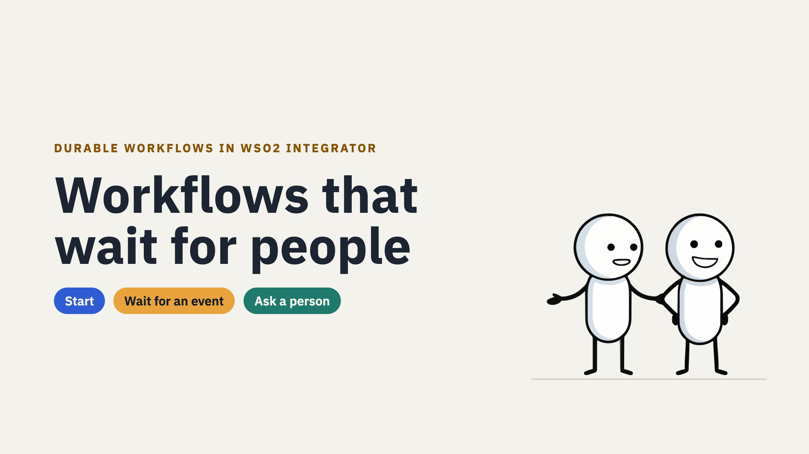
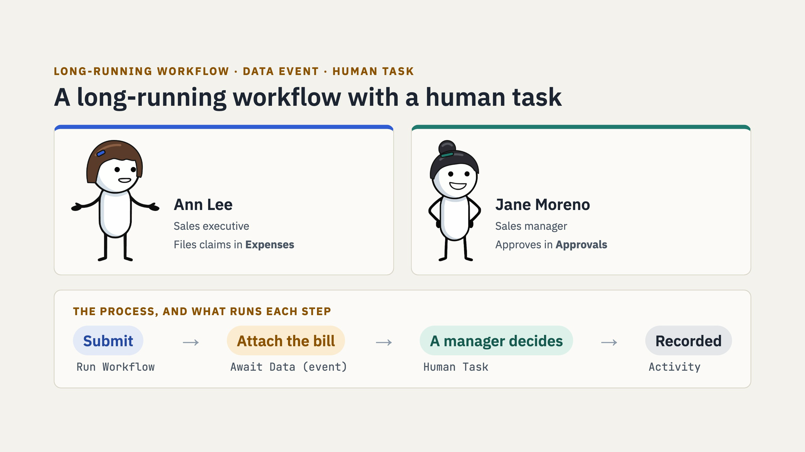
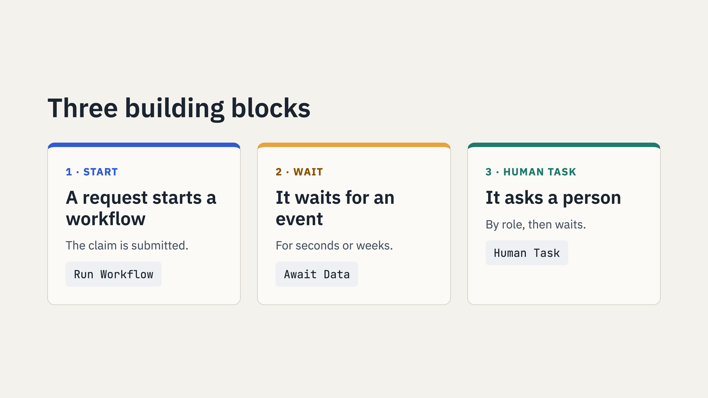
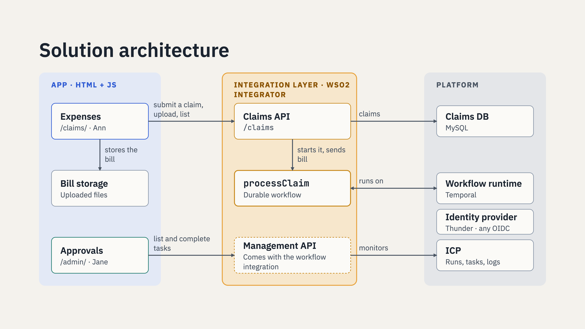
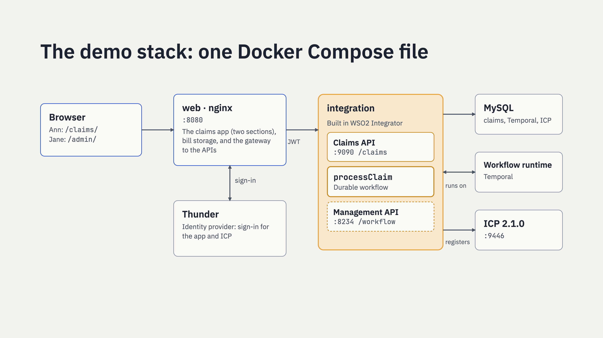
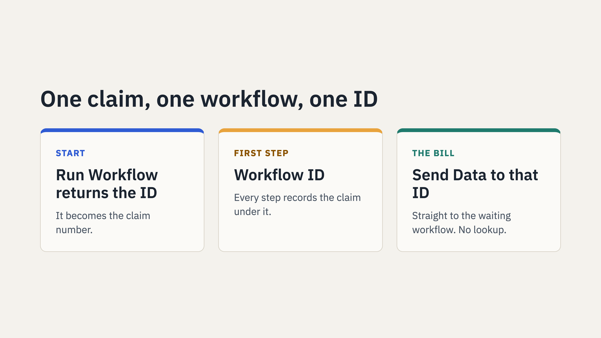

# Workflows that wait for people: a claim approval demo



An expense claim approval, run by a durable workflow built in WSO2 Integrator. Ann files a claim, the workflow asks
her for the bill, then asks her manager, Jane, to approve. Nothing polls, nothing is lost on a restart, and the apps
around it hold no process logic.

Everything runs in one Docker Compose stack: the web app, the integration, sign-in, the WSO2 Integration Control
Plane (ICP), Temporal and MySQL.

## The use case



Ann, a sales executive, files expense claims; Jane, her manager, approves them. Every claim follows the same steps,
and days can pass between any two of them. That is a long-running workflow made of three building blocks:



## Run it

All you need is Docker with Compose, with about 6 GB of memory for Docker. WSO2 Integrator is only needed to open
or change the integration.

```sh
docker compose up -d --build
```

The first start builds the integration and downloads ICP 2.1.0, so it takes a few minutes. When
`docker compose ps` shows everything running, open **http://localhost:8080**.

Sign-in goes through **Thunder**, the identity provider, at https://localhost:8095. The first time, open
https://localhost:8095 and accept its self-signed certificate (the demo's own), then come back.

| User | Password | Groups | Can use |
|---|---|---|---|
| `ann@example.com` | `demo12345` | EMPLOYEE | **Expenses** (`/claims/`): file claims, upload bills |
| `jane@example.com` | `demo12345` | EMPLOYEE, MANAGER | **Expenses**, and **Approvals** (`/admin/`): approve or reject claims |

The ICP console is at **https://localhost:9446**: **Sign in with SSO** as Jane to see the claim workflows and their
tasks, or use `admin` / `admin`.

To start over with empty data: `docker compose down -v`. To keep the stack but clear the demo claims (stops running
workflows, removes new claims and bills): `scripts/reset.sh`.

## Try it

1. Sign in as Ann at http://localhost:8080/claims/ and click **+ New claim**. The claim shows **Bill required**: the
   workflow started and is waiting for the bill.
2. Click **Submit bill** and upload any image. The claim moves to **Waiting for approval**.
3. In a private window (each window keeps its own sign-in), sign in as Jane at http://localhost:8080/admin/. The
   approval task is there, with the bill. Add a comment and **Approve**.
4. Back in Ann's window, the claim shows **Approved** with Jane's comment.
5. In ICP (https://localhost:9446, **Sign in with SSO** as Jane), open the `claims` project: the workflow run, its
   steps and the human task are there.

## What is inside



The app holds no process logic: Expenses calls the Claims API, Approvals calls the Workflow Management API that comes
with the workflow integration. Everything runs in one Docker Compose stack:



| Service | What it is | Port |
|---|---|---|
| `web` | nginx: the two contexts (`/claims/`, `/admin/`), bill storage, and the gateway to the APIs | 8080 |
| `integration` | The claims integration from `integration/`: the Claims API, the `processClaim` workflow, and the Workflow Management API | internal |
| `thunder` | Thunder 1.0.1, the identity provider: sign-in for the apps and the ICP console (`seed/thunder/`) | 8095 |
| `icp` | WSO2 Integration Control Plane 2.1.0, built from its GitHub release zip | 9446 |
| `icp-seed` | Mints the secret the integration registers with ICP, on first start | |
| `temporal` | Temporal 1.29.7, the durable workflow runtime | 7233 |
| `mysql` | MySQL 8.4: claims, ICP and Temporal data (`db/` runs on first start) | 3306 |

### Versions

| Component | Version |
|---|---|
| Ballerina (the integration's build) | 2201.14.1 |
| `ballerina/workflow` | 1.0.0 |
| WSO2 Integration Control Plane | 2.1.0 |
| Thunder | 1.0.1 |
| Temporal (`temporalio/auto-setup`) | 1.29.7 |
| MySQL | 8.4 |
| nginx | 1.30 |

To open and run the integration in WSO2 Integrator, use a version that ships Ballerina 2201.14.1 or later.

### How sign-in works

Thunder is the identity provider. The apps sign in with OpenID Connect (authorization code with PKCE) and send the
access token, a JWT, on every call:

- The **Claims API** validates the token itself (issuer and Thunder's signing keys) and takes the employee from it.
- The **Workflow Management API** gets the same token from the gateway in `X-JWT-Assertion`; it validates it and
  takes the user from the `username` claim and the roles from the `groups` claim, so Jane, in `MANAGER`, sees the
  approval task and Ann does not.
- **Bill storage** accepts a file only with a valid token.
- The **ICP console** signs in with the same Thunder users (SSO); Thunder's groups map to console roles in
  `db/05-icp-sso.sql`.

The users, groups and OAuth clients are declared in `seed/thunder/thunder-resources.yaml`. `scripts/token.sh
ann@example.com` prints a token for scripts and API tests.

## The integration



`integration/` is the WSO2 Integrator project, as built in the designer: open the folder in WSO2 Integrator to see the
workflow, the activities, the HTTP service and the connection.

- `processClaim` reads its own workflow ID, records the claim under it, waits for the bill (`Await Data`), handles
  the attachment, asks a `MANAGER` (`Human Task`), and then either approves and sends the claim for payment or
  rejects it and notifies the employee.
- A claim's id is its workflow's id. The Claims API (`/claims`) starts the workflow with `Run Workflow` and returns
  that id; the workflow's first step reads it with the Workflow ID node, and every activity records the claim under it. The bill route sends the bill to the
  claim's workflow by that id (`Send Data Event`); `GET /claims` lists an employee's claims. The apps show a short
  form of the id, such as `CLM-020417`.
- The Workflow Management API is switched on (`Enable Workflow Management REST API` on the overview), and ICP
  monitoring is enabled (the `wso2/icp.runtime.bridge` import).

To run it from WSO2 Integrator against this stack instead of the container:

```sh
INTEGRATION_HOST=host.docker.internal docker compose up -d --build --scale integration=0
```

then create `integration/claimapproval/Config.toml`:

```toml
dbHost = "localhost"
dbUser = "claims"
dbPassword = "claims"
dbName = "claims"
jwksUrl = "http://localhost:8080/oidc/jwks"

[ballerina.workflow]
mode = "LOCAL"
url = "localhost:7233"

[ballerina.workflow.management.rest]
enableManagementApi = true
enableBasicAuth = false
enableJwtAuth = true
jwtAuthHeader = "X-JWT-Assertion"
jwksUrl = "http://localhost:8080/oidc/jwks"
jwtIssuer = "https://localhost:8095"
userIdClaim = "username"
rolesClaim = "groups"
```

and click **Run**. (Leave ICP monitoring off in the Integrator for this, or point it at https://localhost:9446.)
