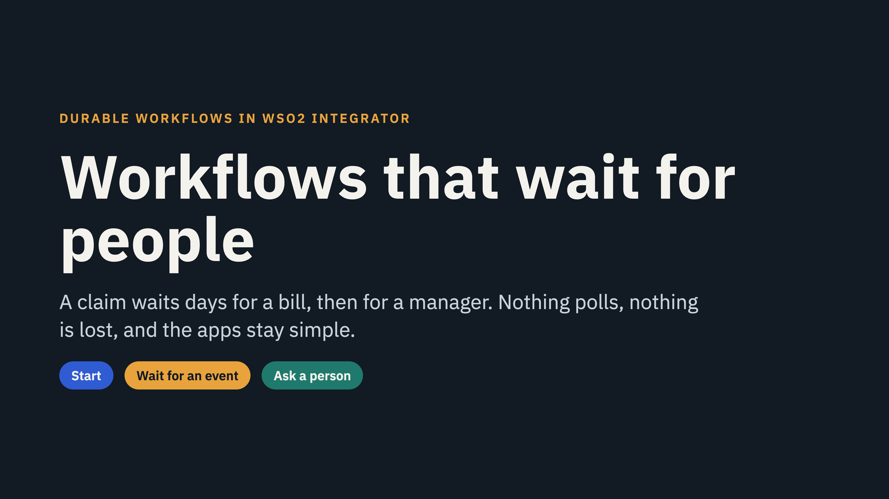
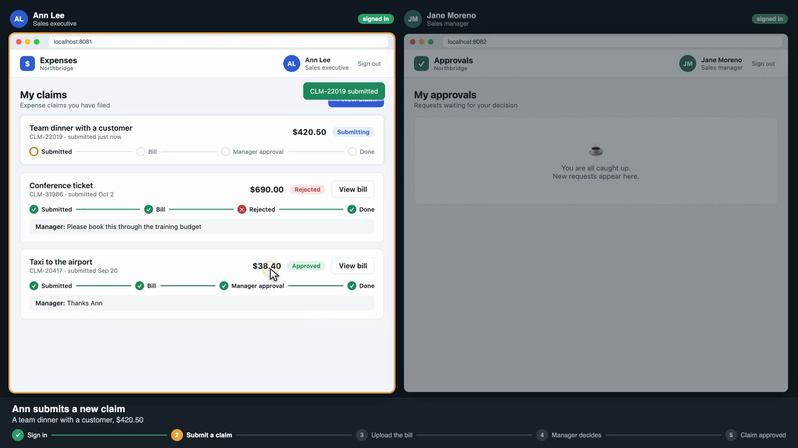
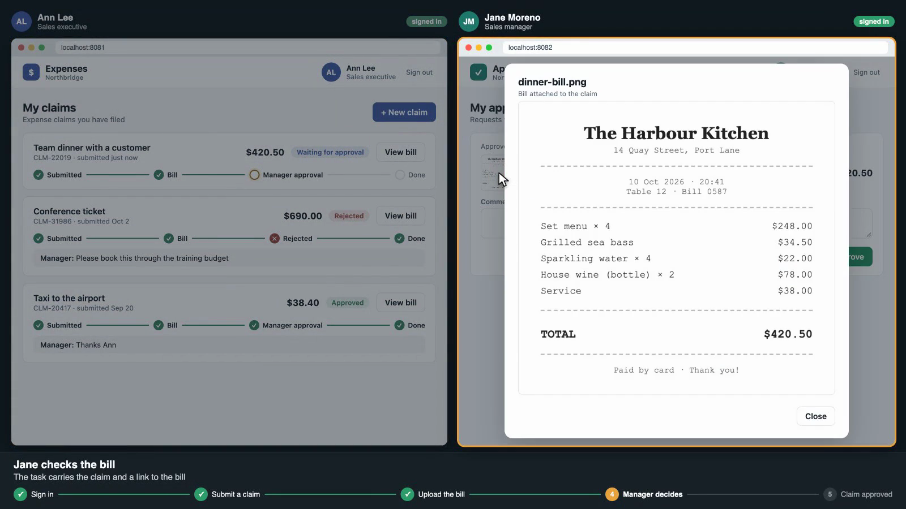
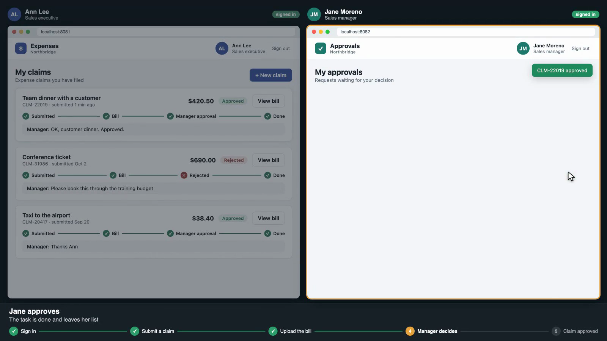
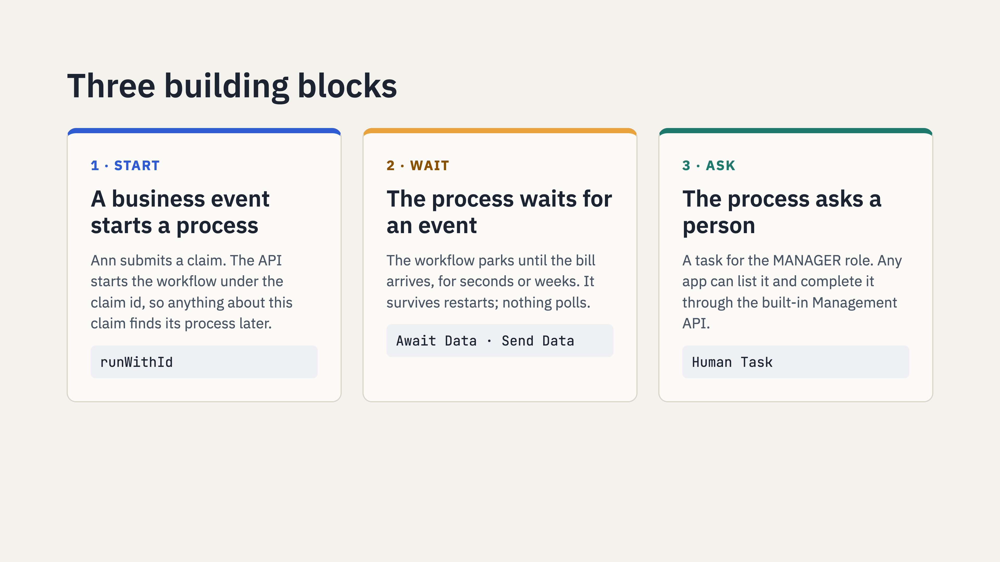
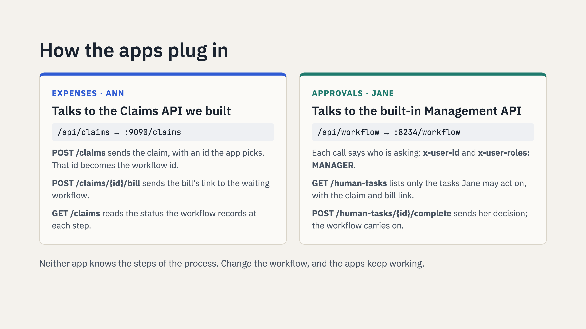
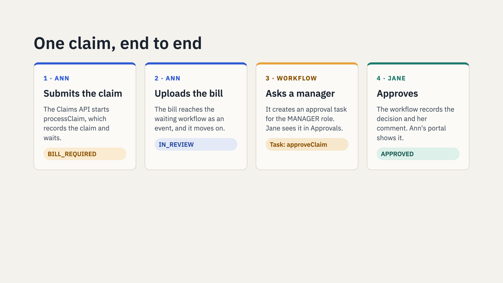
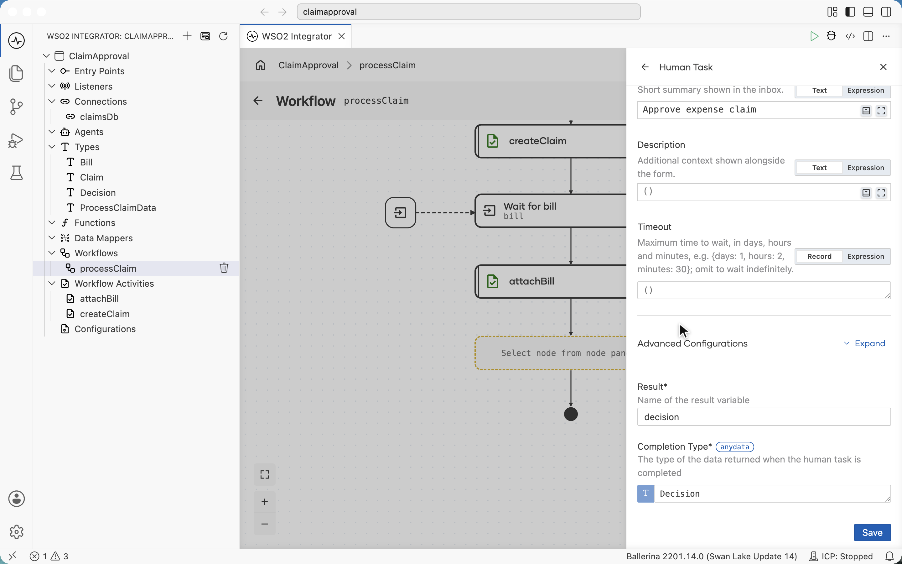
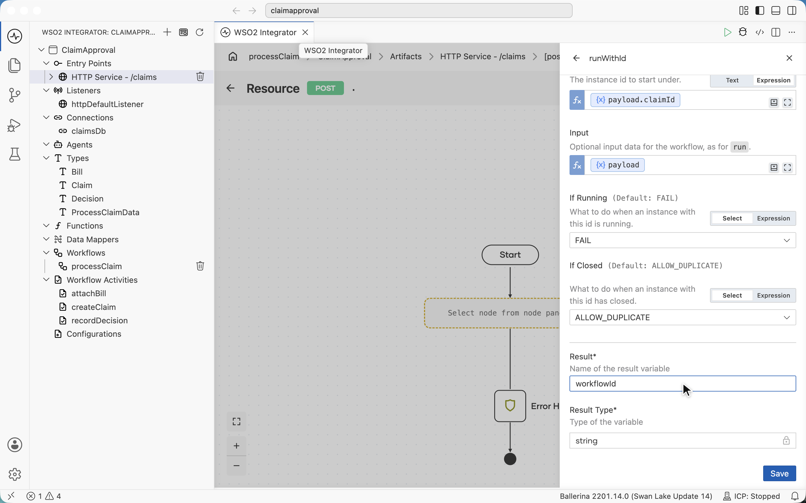
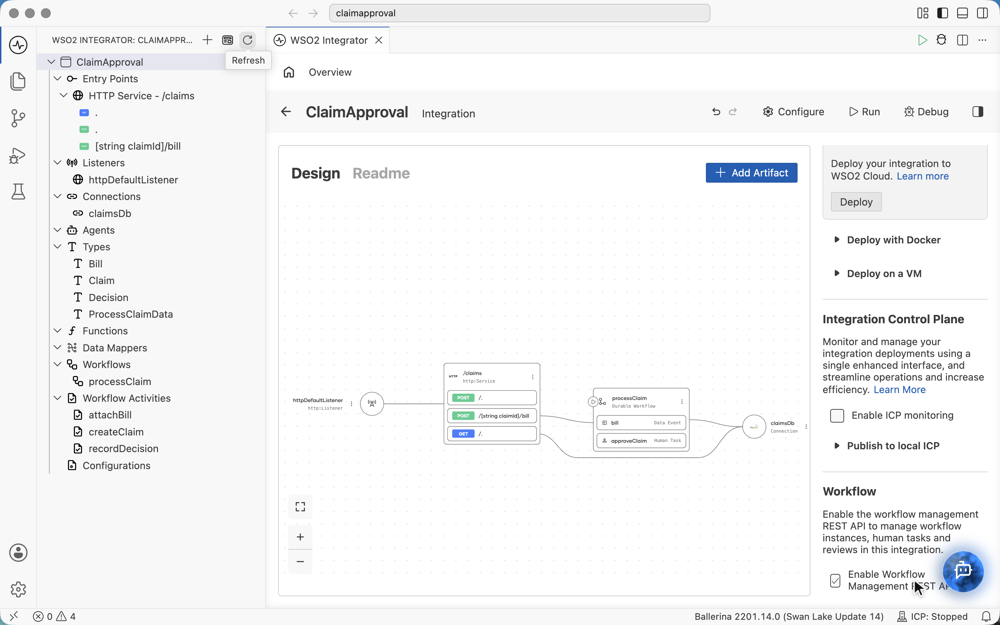

# Workflows that wait for people

*Start a process, wait for an event, ask a person: how durable workflows in WSO2 Integrator take the waiting
out of approval processes.*



Most business processes are not fast. An expense claim waits for a receipt, then for a manager, who might be on
leave. An access request waits for an approver. A loan waits for documents. The work itself takes seconds; the
waiting takes days.

That waiting is where the complexity hides. Something has to remember where each case is, survive a restart in the
middle, know who may act next, and tell the apps what to show. Usually that "something" is a status column, a
polling job and a pile of conditions spread across services and front-ends.

This article walks through a small, complete example (an expense claim approval) and shows how a durable workflow
takes over that job, so the apps around it stay simple.

## One claim, from both sides

Ann files expense claims in a portal called Expenses. Jane, her manager, decides on them in her own console,
Approvals. Two people, two apps, and one process in between.

Ann submits a claim for a team dinner. The process starts, and the first thing it needs is the bill, so her portal
shows **Bill required**. Jane sees nothing yet: there is nothing for her to decide.



Ann uploads the receipt. The process moves on and asks a manager to approve. The task appears in Jane's console with
the claim and the bill attached.



Jane approves with a comment, and Ann's claim shows **Approved**, with the comment. Nobody passed anything on.



Neither app knows the steps of this process. The portal doesn't decide that a bill is needed; it shows the step the
process is waiting at. The console doesn't decide who should approve; it shows the tasks the process has assigned to
Jane's role.

## Why this is harder than it looks

On a whiteboard, this is four boxes. In production, every arrow between them hides a question:

- **Where is each claim?** Hundreds of claims, each waiting at a different step, for days.
- **What happens on a restart?** A deploy at 3 p.m. must not lose the claim that was waiting for a bill since
  Monday, or ask for it twice.
- **Who may act?** Only a manager may approve, and the app must not have to work that out.
- **How do the apps keep up?** Without polling, without duplicating the process rules in every front-end.

A durable workflow answers all four by making the process itself the thing that runs, and waits.

## Three building blocks



The claim approval, and most approval processes, are made of three building blocks.

**Start.** A business event starts a process. Here, submitting a claim starts the `processClaim` workflow, under the
claim's own id (`runWithId`). Anything that later concerns this claim, such as its bill, can find its process by
that id. There is no lookup table to keep.

**Wait for an event.** The workflow parks until the bill arrives. That wait is durable: it costs nothing while it
lasts, it survives restarts, and it doesn't poll. When the Claims API receives the bill, it sends it to the waiting
workflow as a data event, and the process continues from exactly where it stopped.

**Ask a person.** A human task asks someone with the `MANAGER` role to approve. The task carries what the approver
needs to see (the claim and a link to the bill), and its result is a typed decision: approved, and a comment.

In code, the whole process is a few lines. The designer writes it as you build the diagram:

```ballerina
@workflow:Workflow
function processClaim(workflow:Context ctx, Claim input, ProcessClaimData data) returns json|error {
    () _ = check ctx->callActivity(createClaim, {claim: input});
    Bill bill = check wait data.bill;
    () _ = check ctx->callActivity(attachBill, {claimId: input.claimId, billInfo: bill});
    Decision decision = check ctx->awaitHumanTask("approveClaim", userRoles = "MANAGER",
        taskInput = {claimId: input.claimId, employee: input.employee, description: input.description,
            amount: input.amount, billName: bill.fileName, billUrl: bill.fileUrl},
        title = "Approve expense claim");
    if decision.approved {
        () _ = check ctx->callActivity(recordDecision,
            {claimId: input.claimId, status: "APPROVED", remarks: decision.comment});
    } else {
        () _ = check ctx->callActivity(recordDecision,
            {claimId: input.claimId, status: "REJECTED", remarks: decision.comment});
    }
}
```

Anything that touches the outside world (here, writing the claim's status to the database) is an **activity**. The
runtime records each activity's result and retries it by policy, so a replay after a restart never writes twice.

## The solution at a glance


Three groups of components:

- **The apps:** Expenses and Approvals, plus somewhere to store uploaded bills. Ordinary front-ends with no process
  logic.
- **The integration**, built in WSO2 Integrator: a Claims API (the front door), the `processClaim` workflow, and the
  Workflow Management API, which ships with the runtime and is switched on rather than written.
- **The platform:** MySQL for the claims, Temporal as the durable runtime, and the Integration Control Plane for
  operations.

The workflow keeps the claims table current at every step (bill required, in review, approved or rejected), so the
portal can show any claim's state with a plain query.

## How the apps plug in



The apps are wired to two APIs, and that wiring is the whole contract.

**Expenses talks to the Claims API.** It submits a claim with an id it picks, and that id becomes the workflow id. It
stores the bill and sends its link to `/claims/{id}/bill`, which lands in the right waiting workflow. Its claim list
reads the status the workflow records.

**Approvals talks to the Workflow Management API.** Each call says who is asking, with a user id and roles. The API
lists only the tasks that person may act on, with each task's input, and completing a task hands the decision back to
the workflow. Nobody wrote a task inbox. The runtime already has one, and the console is a view of it.

Because neither app knows the steps, the process can change (another approval level, a reminder after three days)
without touching either of them.



## Built in the designer

The integration in this article was built from an empty project in the WSO2 Integrator designer, without writing code
by hand. The connection, the workflow, its activities, the waits and the task are nodes on a diagram; the code above is
what the designer generated.



A few details make the example work, and are worth knowing:

- **Start under a business id.** `runWithId` (from the node panel's search) starts the workflow under the claim id,
  which is what lets the bill find its workflow later.
- **Credentials as configurables.** The database user, password and name are configurables created right in the
  connection form, so each environment sets its own values in `Config.toml`.
- **The task API is a checkbox.** On the integration's overview, **Enable Workflow Management REST API** switches on
  the API the Approvals app uses.





## Takeaways

- Model the process, not the plumbing. Start, wait for an event, ask a person: most approvals are these three blocks.
- Let the runtime do the waiting. A durable wait survives restarts and costs nothing while it lasts.
- Use a business id as the workflow id. Every later event finds its process without a lookup.
- Keep the apps out of the process. They call two APIs, and the workflow can change underneath them.

## See it run

The whole demo (the two apps, the integration, sign-in, the Integration Control Plane, Temporal and MySQL) runs with
one command from [workflow-demo-simple-claim-app](https://github.com/hasithaa/workflow-demo-simple-claim-app):

```sh
docker compose up -d --build
```

Open http://localhost:8080 and sign in as Ann (`ann@example.com`) or Jane (`jane@example.com`), password `demo123`.
The integration is in `integration/`: open it in WSO2 Integrator to see the workflow as you build it.
