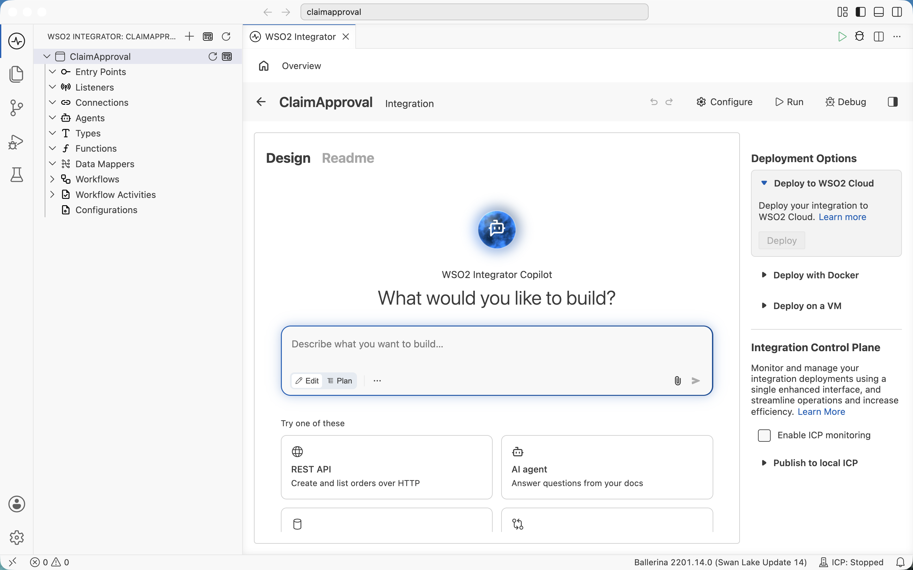
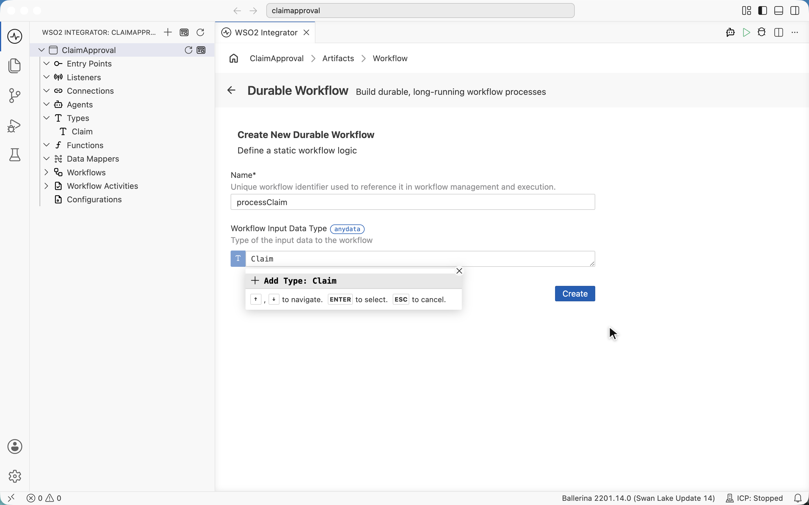
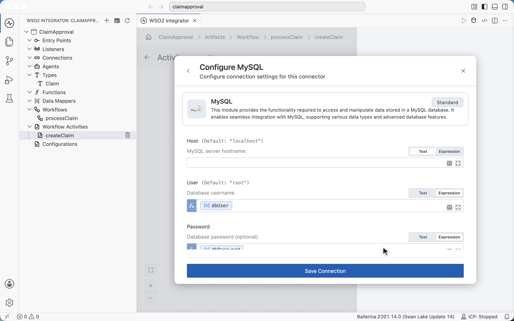
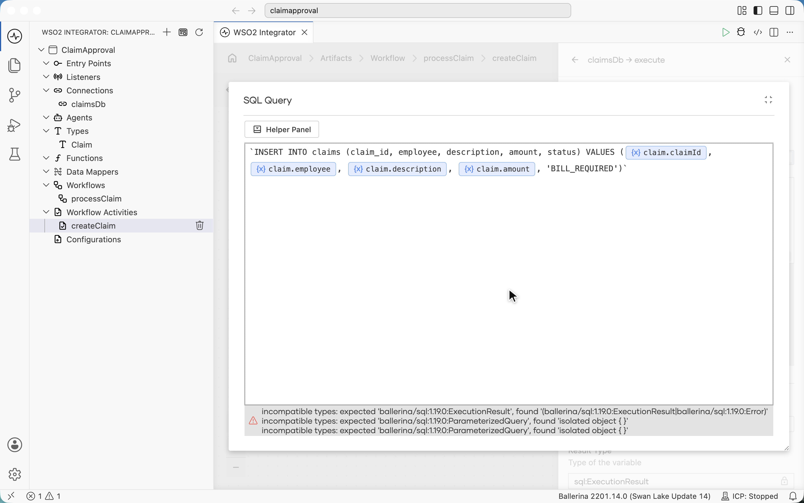
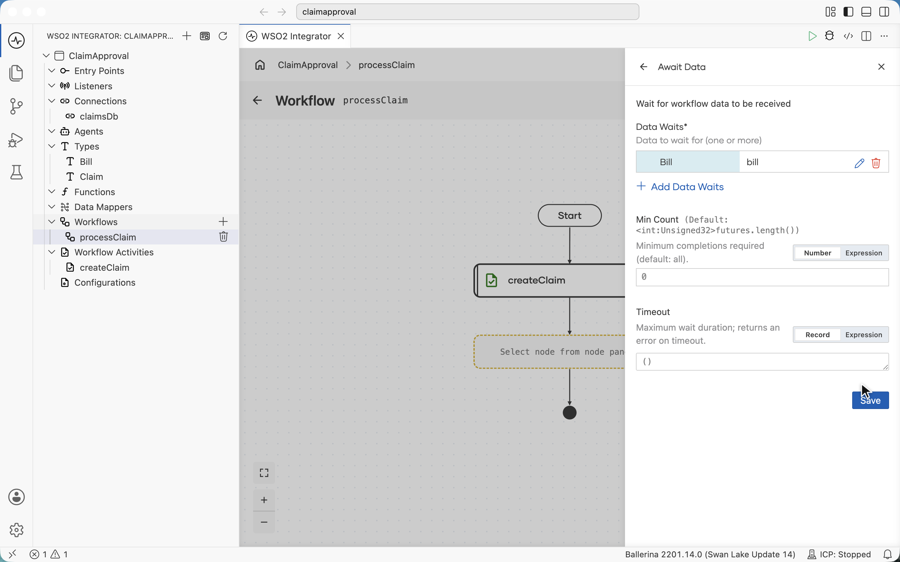
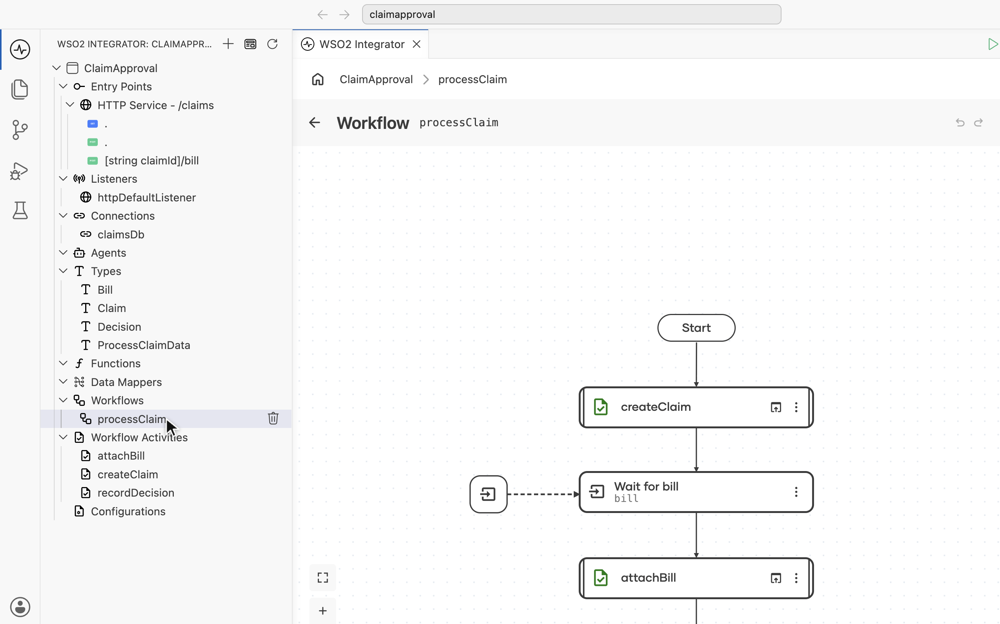
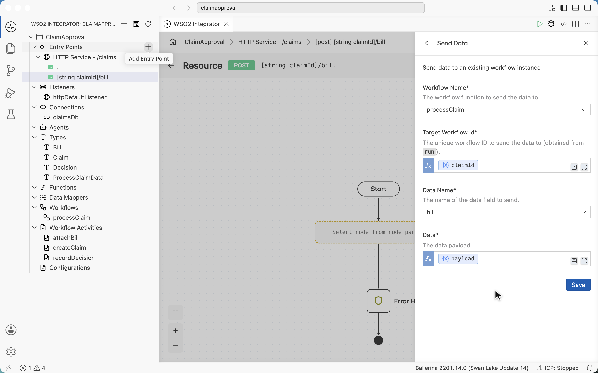
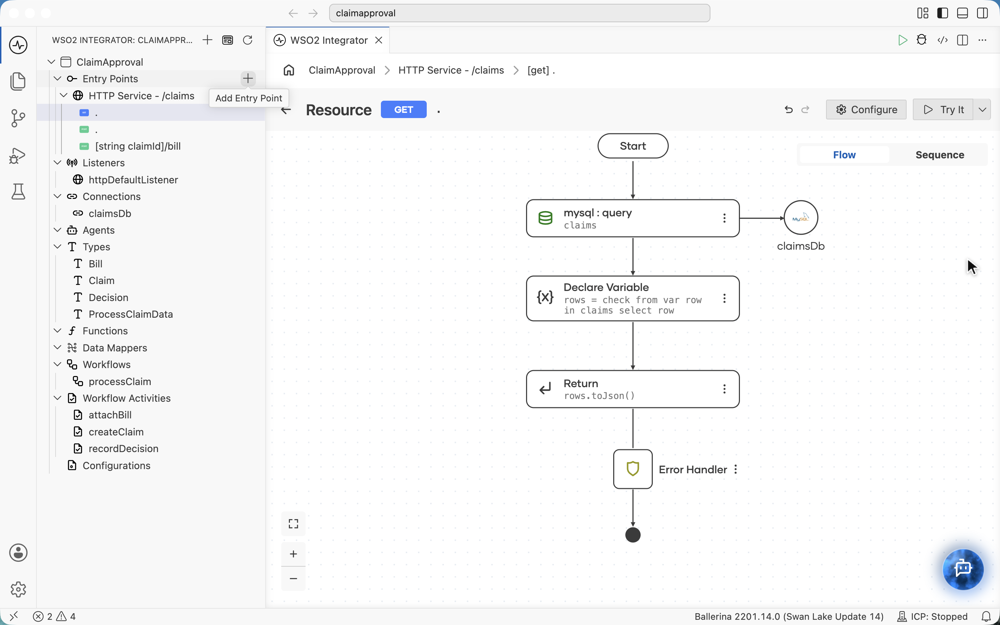
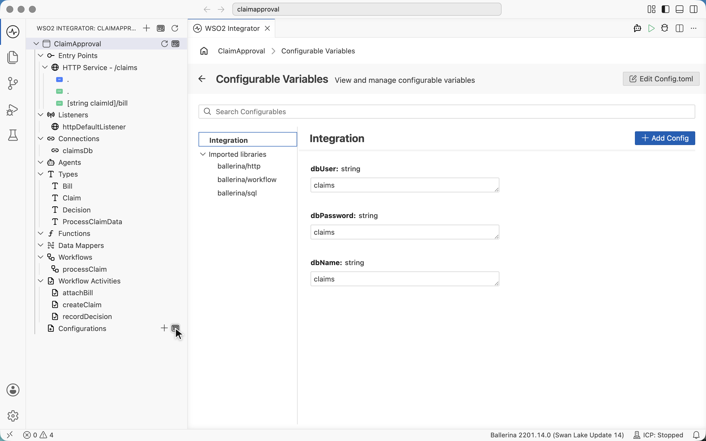

# Build an expense claim approval with a durable workflow in WSO2 Integrator

> Draft outline. Screenshots in `img/` are captured by the build journey
> (`demos/doc-journeys/journeys/demos/claim-approval-steps.ts`) each time it is recorded.

## The use case

Ann files an expense claim. Before anyone looks at it, the claim needs a bill. Once the bill is in, her manager,
Jane, approves or rejects it. Ann sees the outcome in her portal.

Three building blocks cover it, and most approval processes use the same three:

- **Start** a process when something happens (Ann submits a claim).
- **Wait for an event** (the bill upload), for seconds or weeks.
- **Ask a person** (Jane's approval).

## What we build

- A `processClaim` **durable workflow**: record the claim, wait for the bill, attach it, ask a manager, record the
  decision.
- A **Claims API** (`/claims`): submit a claim, upload its bill, list an employee's claims.
- The built-in **Workflow Management API**, switched on with one checkbox, which the manager's app uses to list and
  complete approval tasks.

The two web apps (Expenses for employees, Approvals for managers) are ordinary front-ends with no process logic. The
claims live in MySQL, and the workflow runs on Temporal.

## Before you start

- WSO2 Integrator (1.127 or later).
- MySQL with the `claims` table, and the two web apps: `docker compose up -d` in the demo folder.
- A Temporal dev server: `temporal server start-dev`.

## Step 1: Create the integration

Create a project and an integration named **ClaimApproval**.

## Step 2: Add the durable workflow

**Add Artifact › Durable Workflow**, name it `processClaim`, and create its input type, **Claim**: `claimId`,
`employee`, `description` and `amount`.

## Step 3: Record the claim, connecting to the database on the way

Add a **Call Activity** and create the `createClaim` activity. Activities are where the workflow touches the outside
world: their results are recorded, and they are retried by policy.

Inside the activity, add the database connection from the node panel: **+ Add Connection › MySQL**. Make the user,
password and database name **configurables**, so no credentials live in the code.

Then **claimsDb › Execute** with the `INSERT`, which records the claim as `BILL_REQUIRED`. Long values like this are
easier to write in the field's expanded editor.

## Step 4: Wait for the bill

Add **Await Data** named `bill`, with a new **Bill** type (`fileName`, `fileUrl`). The workflow parks here until the
bill arrives, durably, across restarts.

Then call a second activity, `attachBill`, that stores the bill's link and moves the claim to `IN_REVIEW`.

## Step 5: Ask a manager

Add a **Human Task** `approveClaim` for the **MANAGER** role, titled *Approve expense claim*. The task input carries
the claim and the bill link; the result is a new **Decision** type (`approved`, `comment`).

## Step 6: Record the decision

Add an **If** on `decision.approved`. Each branch calls a `recordDecision` activity, with `APPROVED` or `REJECTED`
and the manager's comment.

## Step 7: Start the workflow from an API

Add an **HTTP Service** at `/claims` with a `POST` resource that takes a `Claim`. Start the workflow with
**runWithId** (find it with the node panel's search), using the claim id as the workflow id. Anything about this
claim, like its bill, can then find its workflow by the claim id.

## Step 8: Send the bill to the waiting workflow

Add `POST [string claimId]/bill`, and in it **Send Data Event**: workflow `processClaim`, the claim id, data name
`bill`, the payload.

## Step 9: List an employee's claims

Add `GET .` with an `employee` query parameter: **claimsDb › Query**, collect the rows, return them as JSON. This is
what the Expenses app shows, and the workflow keeps it current at every step.

## Step 10: Turn on the Workflow Management API

On the overview, check **Enable Workflow Management REST API**. The Approvals app uses it to list the tasks a
manager may act on and to complete them. The overview diagram shows the whole integration.

## Step 11: Configure and run

Set the database values per environment in **Configurations** (`Config.toml`), then **Run**.

## Try it

1. In Expenses, Ann submits a claim: it shows **Bill required**.
2. Ann uploads the bill: **Waiting for approval**, and the task appears in Jane's Approvals.
3. Jane approves with a comment: Ann's claim shows **Approved** and the comment.

## Things to know

- The node panel's search finds library functions such as `runWithId` under **Imported Functions**.
- An activity parameter cannot reuse the name of a workflow variable (the designer says "This name is already
  used"), so `attachBill` takes `billInfo`.
- [Designer quirks still open at the time of writing: list them here or link the issues once filed.]

## Wrap-up

[Closing paragraph: start, wait for an event, ask a person; where to go next (agents, retries, ICP).]
